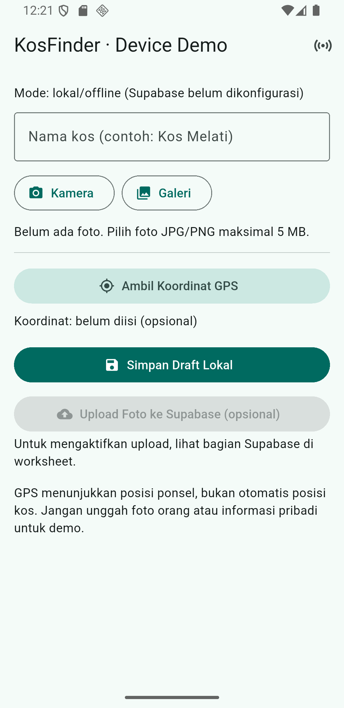
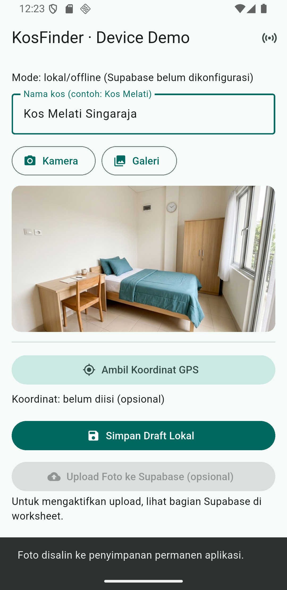
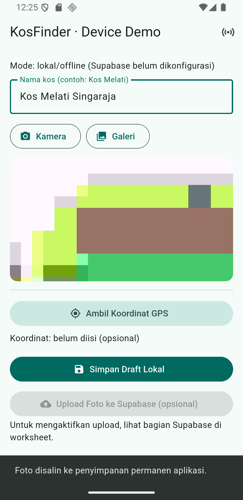
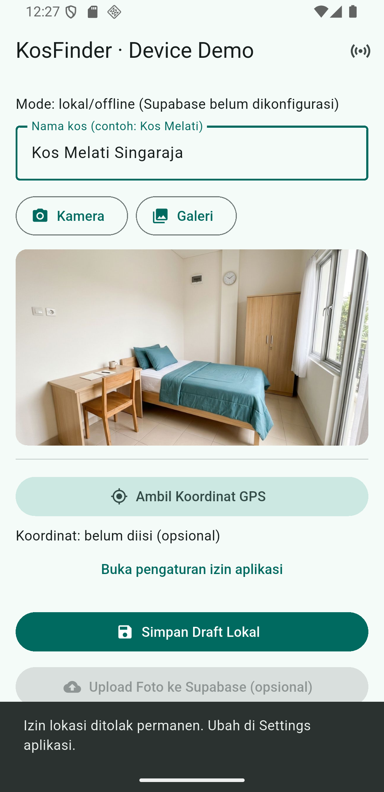
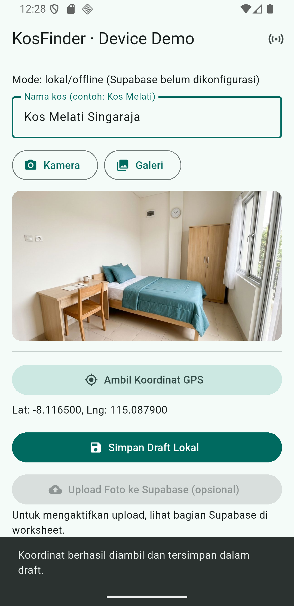
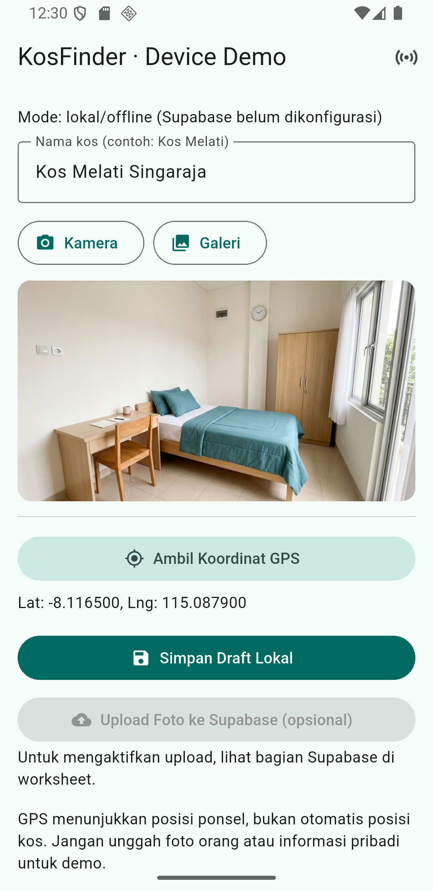
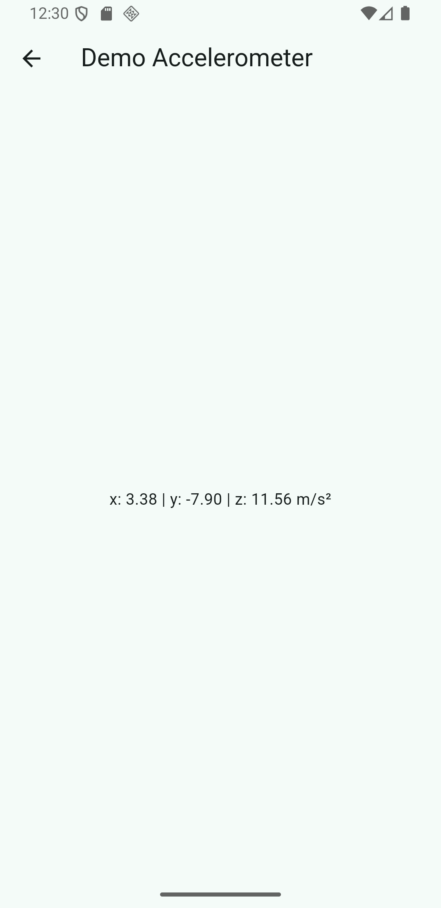

# KosFinder · Device Demo (Worksheet 10 Standalone)

- **Nama:** I Kadek Santa Buana Gotama
- **NIM:** 2415051019
- **Kelas:** PTI 5 IKI
- **Mata Kuliah:** Pemrograman Mobile — Worksheet 10 (Advanced Mobile Features & Device Integration)

Aplikasi Flutter mandiri (`kosfinder_device_demo`) yang mendemonstrasikan integrasi fitur perangkat mobile secara sadar izin (*permission-aware*) tanpa ketergantungan pada backend/Worksheet 9:
1. **Kamera & Galeri (`image_picker`)** dengan validasi format (`JPG/JPEG/PNG`) dan ukuran maksimal `5 MB`.
2. **Penyimpanan Permanen & Draft Lokal (`path_provider` + `shared_preferences`)** yang menyalin foto dari cache ke *Application Documents Directory* (`kosfinder_photos/`) dan menyimpan metadata draft JSON secara lokal menggunakan `SharedPreferencesAsync`.
3. **Lokasi GPS & Penanganan Izin (`geolocator`)** yang memeriksa layanan lokasi aktif, meminta izin secara *on-demand* saat tombol ditekan, serta menyediakan aksi pemulihan ke *Settings* ketika GPS nonaktif atau izin ditolak permanen.
4. **Pengayaan Sensor Accelerometer (`sensors_plus`)** menggunakan `userAccelerometerEventStream()` dengan penanganan `onError` dan pembatalan `StreamSubscription` saat `dispose()`.
5. **Pengayaan Opsional Cloud (`supabase_flutter`)** dengan *Anonymous Sign-In* dan kebijakan *Row Level Security (RLS)* per folder `auth.uid()` (`sql/storage_policy.sql`), yang dapat diaktifkan melalui `--dart-define`.

---

## Struktur Direktori Utama

```text
lib/
  main.dart
  cloud_config.dart
  pages/
    device_demo_page.dart
    sensor_demo_page.dart
  services/
    draft_repository.dart
    device_location_service.dart
    photo_upload_service.dart
sql/
  storage_policy.sql
screenshots/
  01_mode_lokal.png ... 11b_sensor_bergerak.png
test/
  widget_test.dart
```

---

## Cara Menjalankan

### 1. Mode Lokal / Offline (Default — Tanpa Akun Supabase)
```bash
flutter pub get
flutter analyze
flutter test
flutter run
```

### 2. Mode Lokal + Supabase Storage (Opsional Pengayaan)
```bash
flutter run \
  --dart-define=SUPABASE_URL=https://YOUR_PROJECT.supabase.co \
  --dart-define=SUPABASE_PUBLISHABLE_KEY=YOUR_PUBLISHABLE_KEY
```

---

## Hasil Pengujian & Bukti Layar (Emulator Pixel 3a API 36)

| No. | Kasus Uji | Hasil Aktual | Bukti Screenshot |
| --- | --- | --- | --- |
| 1 | Tampilan awal mode lokal | Menampilkan `Mode: lokal/offline (Supabase belum dikonfigurasi)` dan tombol upload nonaktif | `screenshots/01_mode_lokal.png` |
| 2 | Foto via Galeri | Pratinjau foto tampil dan tersalin ke `app_flutter/kosfinder_photos/` | `screenshots/02_foto_galeri.png` |
| 3 | Batalkan Galeri (Negatif) | Muncul snackbar *"Pemilihan foto dibatalkan; draft tidak berubah."*, foto sebelumnya tetap | `screenshots/03_negatif_batal_galeri.png` |
| 4 | Foto via Kamera | Foto hasil kamera tampil dan tersalin ke folder permanen aplikasi | `screenshots/04_foto_kamera.png` |
| 5 | GPS Nonaktif (Negatif) | Muncul pesan error dan tombol **Buka pengaturan layanan lokasi** | `screenshots/05_negatif_gps_nonaktif.png` |
| 6 | GPS Ditolak (Negatif) | Muncul pesan *"Izin lokasi ditolak. Foto dan draft tetap dapat digunakan."* | `screenshots/06_negatif_gps_ditolak.png` |
| 7 | GPS Ditolak Permanen (Negatif) | Muncul pesan error dan tombol **Buka pengaturan izin aplikasi** | `screenshots/07_negatif_gps_ditolak_permanen.png` |
| 8 | Timeout GPS (Negatif) | Muncul pesan *"Waktu mencari GPS habis. Coba dekat jendela/area terbuka."* | `screenshots/07b_negatif_gps_timeout.png` |
| 9 | GPS Diberikan | Koordinat `Lat: -8.116500, Lng: 115.087900` tampil dan tersimpan ke draft | `screenshots/08_gps_berhasil.png` |
| 10 | Tanpa Internet / Airplane Mode (Negatif) | Penyimpanan draft lokal tetap berhasil tanpa koneksi jaringan | `screenshots/09_negatif_offline_simpan_draft.png` |
| 11 | Tutup Paksa & Buka Ulang Aplikasi | Nama kos (`Kos Melati Singaraja`), foto kamar lokal, dan koordinat GPS dipulihkan otomatis | `screenshots/10_draft_pulih_setelah_reopen.png` |
| 12 | Sensor Accelerometer (Diam & Bergerak) | Menampilkan pembacaan percepatan sumbu `x, y, z` secara *real-time* | `screenshots/11a_sensor_diam.png`, `screenshots/11b_sensor_bergerak.png` |

### Galeri Screenshot Bukti

| Mode Lokal Awal | Foto via Galeri | Batal Galeri (Negatif) |
| :---: | :---: | :---: |
|  |  |  |

| Foto via Kamera | GPS Nonaktif (Negatif) | GPS Ditolak (Negatif) |
| :---: | :---: | :---: |
|  |  |  |

| GPS Ditolak Permanen (Negatif) | GPS Berhasil | Simpan Draft Offline (Negatif) |
| :---: | :---: | :---: |
|  |  |  |

| Pemulihan Draft Setelah Reopen | Sensor Accelerometer (Diam) | Sensor Accelerometer (Bergerak) |
| :---: | :---: | :---: |
|  |  |  |
